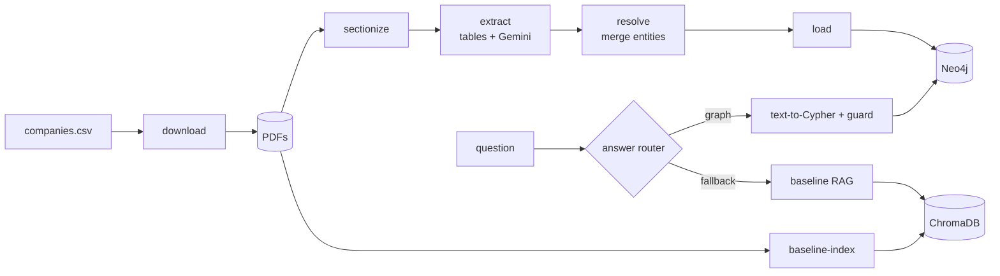

# Graph RAG over Indian Company Annual Reports

Plain vector RAG struggles with questions whose answer is spread across several documents,
such as *"Which people are directors of both Tata Steel and Tata Motors?"*. This project pulls
facts (companies, directors, auditors, subsidiaries) out of FY2023-24 annual reports into a
Neo4j knowledge graph. It answers questions with graph queries that show their path and cite
source pages, and it measures where that beats a plain RAG baseline and where it doesn't.

> Status: **Phase 2 (plain RAG baseline)** is done. See [PROJECT_SPEC.md](PROJECT_SPEC.md) for the full plan.

## Architecture



All LLM calls go through `src/llm/client.py`, which adds an on-disk cache, client-side
rate limits (per minute and per day), retries with backoff, a fallback model, and
token-usage tracking.

## Setup

Requirements: Python 3.11, Docker Desktop, Git.

```powershell
# 1. Virtual environment and dependencies
py -3.11 -m venv .venv
.\.venv\Scripts\Activate.ps1
pip install -r requirements.txt

# 2. Configuration
copy .env.example .env      # then edit .env (see below)

# 3. Start Neo4j (Docker Desktop must be running)
docker compose up -d
# Browser UI: http://localhost:7474  (user: neo4j, password: NEO4J_PASSWORD from .env)

# 4. Check everything works
python -m pytest
python -m src.cli check-neo4j
python -m src.cli check-llm
```

### Get a Gemini API key

1. Go to [Google AI Studio](https://aistudio.google.com/apikey) and sign in with your Google account.
2. Click **Create API key** (create or pick a Google Cloud project when asked).
3. Paste the key into `.env` as `GEMINI_API_KEY=...`. Never commit `.env`; it is in `.gitignore`.
4. Open [aistudio.google.com/rate-limit](https://aistudio.google.com/rate-limit) to see your
   per-minute and per-day limits — **check every model you've set** (`GEMINI_EXTRACTION_MODEL`,
   `GEMINI_QA_MODEL`, and both fallback models), since they often differ. Set each one's numbers
   in `GEMINI_MODEL_LIMITS` in `.env`, or slightly below.

API limits depend on whether billing is enabled on the API key's Google Cloud project. They are
separate from consumer subscriptions such as Google AI Pro.

### Rate limits and resuming

- `GEMINI_MODEL_LIMITS` is a JSON map of model name -> `{"rpm": N, "rpd": N}`. The client waits
  so it never sends more than `rpm` requests per minute to that model, and tracks `rpd` per
  model per day (Pacific time, when Google resets quotas), saved in `data/cache/daily_quota.json`.
  A model not listed has no client-side limit.
- When a model's daily budget is used up — either our own counter, or Gemini itself reporting the
  daily quota is exhausted — that call switches to the configured fallback model, the same as
  when a model is overloaded. The command only stops (with a clear, resumable message) if the
  fallback is also out of quota, or there is no fallback configured. Run it again the next day
  (or once the quota resets) to continue.
- Every successful LLM response is cached in `data/cache/llm/`, so re-runs don't repeat calls.
- If the main model is still overloaded after all retries, that one call switches to
  `GEMINI_EXTRACTION_FALLBACK_MODEL` / `GEMINI_QA_FALLBACK_MODEL` (leave empty to disable).
  The log, the cache entry and the usage summary all record which model actually answered.
  Use fixed model IDs, not `*-latest` aliases, so results are repeatable.

## Commands

```powershell
python -m src.cli --help
```

| Command | Phase | What it does |
|---|---|---|
| `check-llm` | 0 | Plain text call, structured call, then the same call again to confirm the cache |
| `check-neo4j` | 0 | Connects to Neo4j and runs a test query |
| `download` | 1 | Fetch the PDFs in `companies.csv` and verify them against `data/pdf_checksums.json` |
| `sectionize` | 1 | Find the governance report, AOC-1, auditor's report, secretarial audit and related-party note |
| `baseline-index`, `ask --mode baseline` | 2 | Plain RAG baseline |
| `extract` | 3 | Fact extraction (`--section related_party` re-runs one section; `--sample-size 0` skips writing a sample CSV) |
| `check-directorships` | 3 | Check each report's "directorship in other listed entity" claims against the other pilot company's own director list |
| `check-rpt-amounts` | 3 | Check related-party amounts on the PDF page (party's row, FY2024 column, nature heading), record `amount_as_printed`, relabel a nature found under another printed heading, remove nil rows and struck-off companies; no LLM calls |
| `clean-facts` | 3 | Clean saved facts without LLM calls: names (line breaks, footnote markers), other-directorship pages, KMP appointed after the year end, director roles |
| `check-dates` | 3 | Replace appointment/cessation dates later than the report's own date with the same person's other mention (`date_conflict` keeps the printed one); no LLM calls |
| `resolve` | 4 | Entity resolution: people by DIN, then confirmed merges, then name; companies by CIN, then normalised name; look-alikes listed in `data/resolved/uncertain.csv`, not merged. Writes `data/resolved/` and `reports/resolution_summary.md`; no LLM calls |
| `load` | 5 | Load `data/resolved/` into Neo4j: constraints and indexes, then MERGE on stable ids (re-running changes nothing; facts gone from the data are removed), node/relationship counts and three sanity queries. Stable ids: CIN, DIN, or the id saved in `data/resolved/id_registry.csv` (committed) |
| `ask` | 6 | Graph question answering: `--mode graph` (default; falls back to the baseline), `baseline`, or `both` side by side. Shows the answer, route, Cypher, paths and sources (doc + page) |
| `dev-run` | 6 | Run the practice questions (`src/qa/dev_questions.jsonl`) and write `reports/dev_questions_run.md` |
| `eval` | 7 | Answer every verified test question with both systems once (resumable; answers in `data/eval/answers.jsonl`) |
| `eval-score` | 7 | Score the answers (`src/eval/score.py`, `src/eval/scoring_key.jsonl`), export the judge grades and item extractions for hand checking, write `reports/eval_results.md` |

Demo page (Phase 8): `streamlit run src/demo/app.py` (needs Neo4j running), then open
http://localhost:8501. It has a question box, a Graph / Baseline / Both toggle and five example
questions. Each answer shows its route and sources (doc + page). It reuses the `ask` pipeline
and is read-only. Graph-route answers also show:
- the returned paths as an interactive graph (pyvis), with the answer nodes highlighted;
- the generated Cypher in an expandable box.

Sources list only what supports the answer:
- Graph: facts on the paths that reach an answer node, citing the company's own report (not
  the other reports that repeat the fact).
- Baseline: the pages the answer cites, checked against the retrieved excerpts.

Logic: `src/demo/support.py`.

## Project layout

```
graphrag/
├── data/
│   ├── companies.csv        # pilot companies; report URLs filled in by hand
│   ├── pdf_checksums.json   # sha256 of each downloaded report (committed)
│   ├── raw_pdfs/ sections/ extracted/ resolved/ overrides/ cache/
├── src/
│   ├── config.py            # settings from .env
│   ├── cli.py               # typer CLI
│   ├── ingest/
│   │   ├── companies.py     # reads companies.csv
│   │   ├── download.py      # polite downloads + sha256 records
│   │   └── sectionize.py    # heading-based section detection
│   ├── llm/
│   │   ├── client.py        # provider-agnostic client, cache use, usage tracking
│   │   ├── gemini_provider.py
│   │   ├── rate_limiter.py  # per-minute / per-day limits, backoff
│   │   └── cache.py
│   └── qa/
│       ├── tokenizer.py     # token offsets for chunking (same tokenizer as the embedding model)
│       ├── chunking.py      # full-text -> overlapping chunks, with page ranges
│       ├── embeddings.py    # local sentence-transformers wrapper
│       ├── baseline_index.py # Chroma collection: build, skip-if-unchanged, query
│       └── baseline_rag.py  # retrieve top-k chunks, answer with citations
├── tests/
├── docker-compose.yml
├── requirements.txt
├── .env.example
└── PROJECT_SPEC.md
```

## Phase 1: download and sectionize

```powershell
python -m src.cli download              # all companies; already-downloaded files are skipped
python -m src.cli sectionize            # writes data/sections/<SYMBOL>/<section>.json + summary.json
python -m src.cli sectionize -c INFY --force   # redo one company
```

- Downloads send a browser User-Agent (BSE/NSE return 403 otherwise), retry 429/5xx with
  backoff, pause between requests to the same host, and record each file's sha256 in
  `data/pdf_checksums.json` (committed). A later download that doesn't match is kept as
  `<SYMBOL>.pdf.new` and reported, never silently swapped in.
- `sectionize` reads heading lines (bold or larger than body text) with PyMuPDF and finds
  five sections per report: `corporate_governance`, `subsidiaries_aoc1`, `auditor_report`
  (standalone), `secretarial_audit` (the company's own Form MR-3) and `related_party`
  (the standalone note), plus any subsidiaries' own secretarial audit reports found alongside
  the company's own (see "Known limitations"). Each JSON holds the PDF page range, the text
  of every page and the tables found (PyMuPDF first, pdfplumber as a second pass). Page
  numbers are PDF page numbers, not printed ones.
- It also checks the company's CIN: the most frequent CIN in the PDF must equal the one in
  `companies.csv`.
- Re-running skips a company whose `summary.json` came from the same PDF and detector version.

## Evaluation results

Phase 7, 95 verified questions, both systems run once with `gemini-3.5-flash-lite` at
temperature 0. Full tables, failure list with reasons, and every answer:
`reports/eval_results.md`. Mean score per question (F1 for lists, 1/0 otherwise; fully correct
in brackets):

| Category | n | Graph | Baseline | Winner |
|---|---|---|---|---|
| 1hop | 16 | 0.98 (94%) | 0.92 (88%) | graph |
| 2hop | 20 | 0.88 (80%) | 0.75 (60%) | graph |
| 3hop | 15 | 0.62 (53%) | 0.37 (20%) | graph |
| aggregation | 20 | 0.54 (35%) | 0.58 (35%) | baseline |
| none/unanswerable | 9 | 0.67 | 0.89 | baseline |
| All except text-only | 80 | 0.74 (65%) | 0.68 (55%) | graph |
| text_only (judge, hand-checked) | 15 | 0.87 | 0.87 | tie |

- Neither system got any of the four aggregation counts right; the graph fell back to the
  baseline on all four.
- Text-only: the LLM judge agreed with the user's hand check on 28 of 30 grades (93%). The two
  changes are t078 for both systems, from 0.5 to 1. ₹140,987 crore is the same value as the
  gold ₹1,40,987.43 crore, stated to the nearest crore, so it was graded under the numbers rule
  that formatting and units can differ.

## Known limitations

- Only the Gemini provider is implemented. Ollama is deferred.
- Section rules were tuned on the 5 pilot reports. Other companies' layouts may need new
  patterns; `sectionize` reports anything it can't find instead of guessing.
- Table extraction is best-effort: PyMuPDF's table finder is tried first on every page (it
  reads rotated pages correctly, unlike pdfplumber), with pdfplumber as a second pass on
  upright pages. Both only find *ruled* tables; a wide, rotated, borderless table like Tata
  Steel's or Tata Motors' AOC-1 subsidiary list still returns nothing. Full page text is
  always saved regardless, so the LLM can still read these tables as text in Phase 3; sending
  page images to Gemini is the next option if that's not good enough.
- Some table cells lose their first letter, apparently because the detected cell edge clips
  the first glyph (Tata Steel p.249 "otal", p.409 "utstanding payables", "ale of Fixed
  Assets"; Infosys p.114 "pril", "uary"). It's not the ligature problem fixed in `sectionize`:
  the letter is missing, not reordered, so it can't be repaired from the cell's own text.
  None of these tables are parsed into facts (related-party facts come from page text via the
  LLM), so extraction isn't affected, but anything that later reads these table cells is.
- The company's own secretarial audit report is kept as `secretarial_audit.json`; any material
  subsidiaries' own secretarial audit reports in the same PDF (Tata Motors has 2, Tata Steel
  has 1) are kept too, as separate `secretarial_audit_subsidiary_N.json` files tagged with
  the subsidiary's name, so they're never confused with the parent's own report.
- Auditors of subsidiaries are usually not named in the parent company's report. The exception
  is the corporate governance report's table of material subsidiaries, which names each one's
  statutory auditor (Tata Motors p.258: KPMG for the JLR companies, among others). Extraction
  does not read that table, so the graph has no subsidiary auditors. Found during test-set
  verification; deliberately not fixed before Phase 7 to avoid tuning to the test set.
- Extraction accuracy: a 50-fact sample was checked against the source pages with AI
  assistance (45/47 confirmed, 0 wrong, 2 unconfirmed, now fixed), on top of the automatic
  checks: completeness against the AOC-1 rows and the directors' certificate, the
  cross-report directorship check, related-party amounts checked on the PDF page, and the
  date rule (`reports/extraction_summary.md`).

## Phase 2: plain RAG baseline

```powershell
python -m src.cli baseline-index                       # chunk + embed + index every company's full PDF text
python -m src.cli baseline-index -c TCS --force         # redo one company
python -m src.cli ask --mode baseline "Who audits Tata Consumer Products?"
```

- Each company's PDF (every page, not just the sections from Phase 1) is read with the same
  PyMuPDF reader `sectionize` uses, then split into overlapping chunks of about 500 tokens
  (60-token overlap) using the embedding model's own tokenizer, so chunk sizes match what it
  actually sees. Every chunk keeps the company name and the page range it came from.
- Chunks are embedded locally with `BAAI/bge-small-en-v1.5` (sentence-transformers, no API
  calls, no cost) and stored in a persistent ChromaDB collection under `data/vector_store/`.
  Re-running `baseline-index` skips a company whose PDF (by sha256) and embedding model
  haven't changed.
- `ask --mode baseline` retrieves 12 chunks by hybrid search (embeddings + BM25 keywords, only
  from the companies the question names, if any) and asks `GEMINI_QA_MODEL` (temperature 0) to
  answer using only those excerpts, citing
  `[Company, p.N]` for every claim. The CLI also prints the distinct (company, page) sources used.
- This baseline is what the graph pipeline (Phase 6+) has to beat on multi-hop questions; it's
  built to be a fair, reasonably strong baseline, not a strawman.
- Early manual test questions and their answers are recorded in `src/eval/baseline_notes.md`
  (candidates for the Phase 7 evaluation set).

## Phase 6: graph question answering

`ask` answers graph first:

1. **Entity lookup** (`src/qa/entity_lookup.py`): the QA model lists the names in the question as
   written; each is matched to a node through a table of the pilot companies' common names and
   tickers ("TaMo", "TCS", "Infy") and the `entity_names` full-text index over names and aliases.
   A name that fits several nodes ("Krishnakumar", "JLR") stops the question and lists them.
2. **Text to Cypher** (`src/qa/text_to_cypher.py`) with `src/graph/schema_info.py`: schema, the
   relationship categories (ownership: SUBSIDIARY_OF, MERGED_INTO; people: DIRECTOR_OF, KMP_OF;
   money: RELATED_PARTY_TXN, GROUP_OF; services: AUDITED_BY; names: FORMERLY_NAMED), the rules
   ("connected" = ownership, people and money; auditors only when asked; name links never;
   "the board" = FY2024 directors: current, own report, not joined after the year end), and
   checked examples. Prose questions are routed to the baseline.
3. **Guard** (`src/qa/cypher_guard.py`): writes and unknown procedures are refused, a LIMIT is
   added when missing, the query is EXPLAINed and run in a read-only session with a timeout. A
   rejected, invalid, failing or empty query is regenerated with the error, up to 2 times; then
   the baseline answers.
4. **Answer** (`src/qa/answer.py`): worded from the rows only; paths and sources are read off the
   paths the query returns.

### Practice questions (not for Phase 7)

`src/qa/dev_questions.jsonl` holds 16 practice questions (1-step, 2-step, 3-step, counting,
text-only, one ambiguous name) used to build and tune Phase 6; `dev-run` runs them and writes
`reports/dev_questions_run.md`. **They must not be reused, or reworded, in the Phase 7 test set:**
the system was tuned on them, so they would overstate its accuracy.

### To do before Phase 7

- Done (Phase 7 step 1): the baseline now uses hybrid search (embeddings + BM25, reciprocal
  rank fusion keeping each method's top hits), 12 chunks, a company filter when the question
  names pilot companies (an equal share each for several), and the graph route's answer model
  at temperature 0. Before/after on the three early questions: `src/eval/baseline_notes.md`.
- `GEMINI_QA_MODEL` is currently `gemini-3.5-flash-lite` (free tier) because `gemini-3.8-flash`'s
  free daily quota (~20 requests) is too small for evaluation-scale question answering. Before
  Phase 7, we may enable billing on the API key's Google Cloud project to use a stronger QA
  model instead. If so: replace `GEMINI_API_KEY` with a fresh key first (the current one was
  shared in chat and is only safe to keep while on the free tier), and set a spend cap on that
  project before switching models.

## Phase 7: evaluation (complete; results above and in `reports/eval_results.md`)

- `src/eval/question_plan.md`: the test-set mix, fixed and committed before any question was
  drafted (15 1hop, 20 2hop, 15 3hop, 20 aggregation, 15 text_only, 10 none/unanswerable).
  The actual mix is 16 1hop and 9 none/unanswerable: t091 moved to 1hop during verification
  (see the plan's dated note), before any evaluation ran.
- `src/eval/questions.jsonl`: 95 questions written from the PDFs (not the graph), each with a
  gold answer and the PDF pages to check it. None repeats or rewords a practice question
  (`src/qa/dev_questions.jsonl`, `src/eval/baseline_notes.md`). Verification was AI-assisted
  (checked against the cited pages) plus the user's own counts for t055 and t067; all 95 are
  `verified: true`.
- Scoring followed `src/eval/scoring_rules.md`. Before any answer was read, a blind LLM item
  extractor plus deterministic matching (`src/eval/score.py`, `src/eval/scoring_key.jsonl`) was
  committed. The user spot-checked 24 of the 159 extractions and found no errors. Failures the
  route and score couldn't explain were diagnosed against the graph
  (`src/eval/failure_diagnoses.jsonl`). The user hand-checked all 30 judge grades
  (`src/eval/judge_handcheck.jsonl`).

## Phase 3: fact extraction

`extract` runs every LLM call at temperature 0, and writes `data/extracted/<SYMBOL>.jsonl`
plus `<SYMBOL>.run.json` (calls used, facts dropped by the evidence check, director copies
merged, possible matches left unmerged, regressions).

- **No silent regressions:** if a re-run finds fewer facts of a type in a section than the
  saved previous run, the previous facts are kept and the drop is printed. `--accept-fewer`
  keeps the new result anyway (still printed).
- **Director copies:** the same director often comes out once with a DIN and once without
  (only some pages print it). A copy without a DIN is merged into the one director with the
  same normalized name and a DIN; ambiguous cases (several DINs for a name, or a match on
  initials only, like "Om Prakash Bhatt" / "O P Bhatt") are listed, not merged.

### Notes for Phase 4 (entity resolution)

- **Renamed subsidiary:** "TCS Technology Solutions AG" was renamed "TCS Technology Solution
  GmbH" (note on TCS's Form AOC-1, p.307). Treat the two names as the same company, along
  with "TCS Technology Solutions GmbH", the spelling in the AOC-1 table itself (p.306).
- **Merged subsidiary:** "Saudi Desert Rose Holding B.V. merged with Tata Consultancy Services
  Netherlands BV w.e.f. August 29, 2023" (same AOC-1 notes, p.307). Saudi Desert Rose shouldn't
  appear as a current, separate subsidiary after that date; record the merger rather than
  treat the two as one company.
- **Lookalike characters:** Tata Steel's PDF text renders "Neelachal Ispat Nigam Limited" as
  "Neelachal lspat Nigam Limited" (lowercase "l" for capital "I", a font-encoding quirk). Name
  matching should treat "l" and "I" as lookalikes (e.g. fold both to one character) before
  fuzzy-matching company or person names, so this doesn't become a duplicate entity.
- **Directorships reported by another company:** `other_directorship` facts come from one
  company's director table ("Directorship in other listed entity") and describe a seat on a
  *different* company's board; `data.reported_by` says whose report made the claim. The other
  company's own report is the authority on its board, so these should merge into, not
  duplicate, that company's own `director` facts (`check-directorships` lists the ones that
  don't line up).
- **Rules added while resolving (2026-10-22):** a former name ("formerly known as X",
  "previously X") never merges on its own, because another company may hold that name now
  (TMF Business Services Limited was formerly Tata Motors Finance Limited; Jaguar Land Rover
  Limited was previously Jaguar Cars Limited; Tata Motors lists both of each pair). Two rows
  of the same report's subsidiary list are always two companies, even against an override.
  Look-alike names go to `data/resolved/uncertain.csv`; decisions go in
  `data/overrides/merges.csv` (people: `to_din`; companies: `action` merge / split /
  merged_into / formerly_named).

### Notes for Phase 5 (loading): schema additions from Phase 4

Phase 4's output (`data/resolved/entities.jsonl`, `relations.jsonl`) adds to the schema in
PROJECT_SPEC.md:

- **`RelatedPartyGroup {id, name, reported_by}`**: a related-party "party" that is a category,
  not one company ("Subsidiaries", "Associates", "Promoter", "Subsidiaries of Tata Sons Private
  Limited"). One node per report and label, since Tata Steel's "Subsidiaries" are not Tata
  Consumer's. `RELATED_PARTY_TXN` can point at a Company or a RelatedPartyGroup.
- **`(RelatedPartyGroup)-[:GROUP_OF]->(Company)`** where the label names the company it is
  about (Tata Sons Private Limited).
- **`(Company)-[:MERGED_INTO {note}]->(Company)`**: Saudi Desert Rose Holding B.V. into Tata
  Consultancy Services Netherlands BV, w.e.f. August 29, 2023. Two companies, not one.
- **`(Company)-[:FORMERLY_NAMED {former_name}]->(Company)`**: a name link, not a company
  link. Jaguar Land Rover Limited was previously named Jaguar Cars Limited, the name a
  different company holds now.
- **`DIRECTOR_OF`** combines every mention of one seat: `status` is current unless the only
  stated status is ceased ("appointed" and "current" both mean current), all dates are kept,
  and a seat known only from another company's report ("Directorship in other listed
  entity") has no status. Its `sources` list says whose report said what.
- Every relation carries `sources: [{source_doc, page, evidence, fy, reported_by}]` rather
  than a single source, since merged relations can have several.
- Companies without a CIN (all but the five reporting companies) get the Phase 4 entity id
  (`company:NNNN`) plus `name_normalized`, as the spec allows for foreign subsidiaries. The
  ids are numbered afresh on every `resolve` run, and `name_normalized` (+ country) is not
  unique on its own (two rows of one subsidiary list can share a name when the list has no
  country column), so Phase 5 needs a stable key before loading with MERGE.
