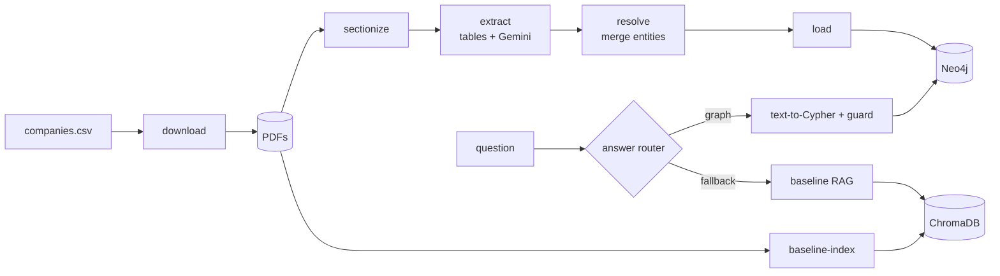

# Graph RAG over Indian Company Annual Reports

Plain vector RAG struggles with questions whose answer is spread across several documents,
such as *"Which people are directors of both Tata Steel and Tata Motors?"*. This project pulls
facts (companies, directors, auditors, subsidiaries) out of FY2023-24 annual reports into a
Neo4j knowledge graph. It answers questions with graph queries that show their path and cite
source pages, and it measures where that beats a plain RAG baseline and where it doesn't.

> Status: **Phase 0 (setup)** is done. See [PROJECT_SPEC.md](PROJECT_SPEC.md) for the full plan.

## Architecture



All LLM calls go through `src/llm/client.py`, which adds an on-disk cache, client-side
rate limits (per minute and per day), retries with backoff, a fallback model, and
token-usage tracking.

## Setup

Requirements: Python 3.11, Docker Desktop, Git.

```powershell
# 1. Virtual environment and dependencies
py -3.11 -m venv .venv
.\.venv\Scripts\Activate.ps1
pip install -r requirements.txt

# 2. Configuration
copy .env.example .env      # then edit .env (see below)

# 3. Start Neo4j (Docker Desktop must be running)
docker compose up -d
# Browser UI: http://localhost:7474  (user: neo4j, password: NEO4J_PASSWORD from .env)

# 4. Check everything works
python -m pytest
python -m src.cli check-neo4j
python -m src.cli check-llm
```

### Get a Gemini API key

1. Go to [Google AI Studio](https://aistudio.google.com/apikey) and sign in with your Google account.
2. Click **Create API key** (create or pick a Google Cloud project when asked).
3. Paste the key into `.env` as `GEMINI_API_KEY=...`. Never commit `.env`; it is in `.gitignore`.
4. Open [aistudio.google.com/rate-limit](https://aistudio.google.com/rate-limit) to see your
   per-minute and per-day limits for the Flash model. Set `GEMINI_RPM` and `GEMINI_RPD` in
   `.env` to those numbers or slightly below.

API limits depend on whether billing is enabled on the API key's Google Cloud project. They are
separate from consumer subscriptions such as Google AI Pro.

### Rate limits and resuming

- `GEMINI_RPM` makes the client wait so it never sends more than that many requests per minute.
- `GEMINI_RPD` counts requests per model per day (Pacific time, when Google resets quotas), saved in
  `data/cache/daily_quota.json`. When the budget is used up, or Gemini itself reports the daily
  quota is exhausted, the command stops with a clear message. Run it again the next day to continue.
- Every successful LLM response is cached in `data/cache/llm/`, so re-runs don't repeat calls.
- If the main model is still overloaded after all retries, that one call switches to
  `GEMINI_EXTRACTION_FALLBACK_MODEL` / `GEMINI_QA_FALLBACK_MODEL` (leave empty to disable).
  The log, the cache entry and the usage summary all record which model actually answered.
  Use fixed model IDs, not `*-latest` aliases, so results are repeatable.

## Commands

```powershell
python -m src.cli --help
```

| Command | Phase | What it does |
|---|---|---|
| `check-llm` | 0 | Plain text call, structured call, then the same call again to confirm the cache |
| `check-neo4j` | 0 | Connects to Neo4j and runs a test query |
| `download`, `sectionize` | 1 | Fetch PDFs and find relevant sections |
| `baseline-index`, `ask --mode baseline` | 2 | Plain RAG baseline |
| `extract` | 3 | Fact extraction |
| `resolve` | 4 | Entity resolution |
| `load` | 5 | Load into Neo4j |
| `ask` | 6 | Graph question answering |
| `eval` | 7 | Evaluation against the baseline |

## Project layout

```
graphrag/
├── data/
│   ├── companies.csv        # pilot companies; report URLs filled in by hand
│   ├── raw_pdfs/ sections/ extracted/ resolved/ overrides/ cache/
├── src/
│   ├── config.py            # settings from .env
│   ├── cli.py               # typer CLI
│   └── llm/
│       ├── client.py        # provider-agnostic client, cache use, usage tracking
│       ├── gemini_provider.py
│       ├── rate_limiter.py  # per-minute / per-day limits, backoff
│       └── cache.py
├── tests/
├── docker-compose.yml
├── requirements.txt
├── .env.example
└── PROJECT_SPEC.md
```

## Evaluation results

Not yet available (Phase 7).

## Known limitations

- Only the Gemini provider is implemented. Ollama is deferred.
- Auditors of subsidiaries are usually not named in the parent company's report, so questions
  about them are marked unanswerable from this data.
